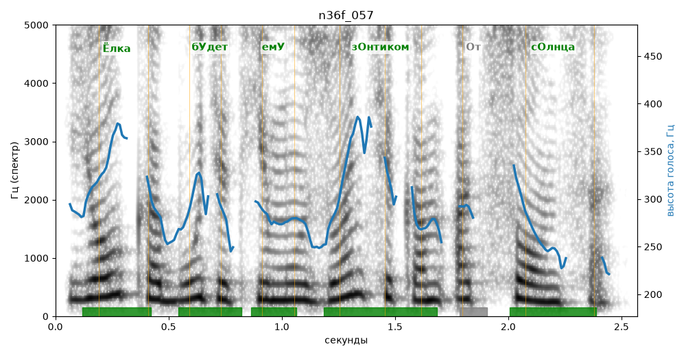

# n36f_057

Голос: **Филя, сборка 36d** · длительность 2.6 с
Эталон: Ёлка будет ему зонтиком от солнца!
Распознано: Ёлка будет ему зонтиком от солнца.
Слова: все совпали

## Ударения
(где нужно: ruaccent)

| слово | нужно | у голоса | |
|---|---|---|---|
| ёлка | Ёлка | Ёлка | ✓ |
| будет | бУдет | бУдет | ✓ |
| ему | емУ | емУ | ✓ |
| зонтиком | зОнтиком | зОнтиком | ✓ |
| солнца | сОлнца | сОлнца | ✓ |

## Интонация
- ✓ «ёлка будет ему зонтиком от солнца!» — выделено слово «ёлка» (+2.3 пт)
- Диапазон голоса 7.1 полутонов (живо), средняя высота 284 Гц

## Паузы и темп
- паузы на своих местах
- Темп 5.3 слога/с (нормально)

_Синяя линия — высота голоса. Над словами заглавная буква — где ударение должно быть; красным — голос поставил не туда (уверенно), оранжевым — возможно._
