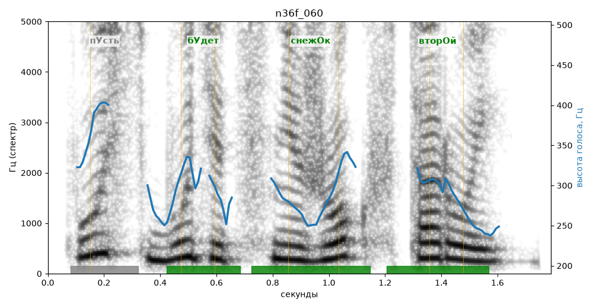

# n36f_060

Голос: **Филя, сборка 36d** · длительность 1.8 с
Эталон: Пусть будет Снежок Второй!
Распознано: Пусть будет снежок второй.
Слова: все совпали

## Ударения
(где нужно: ruaccent)

| слово | нужно | у голоса | |
|---|---|---|---|
| будет | бУдет | бУдет | ✓ |
| снежок | снежОк | снежОк | ✓ |
| второй | вторОй | вторОй | ✓ |

## Интонация
- ✓ «пусть будет снежок второй!» — выделено слово «пусть» (+4.7 пт)
- Диапазон голоса 8.0 полутонов (живо), средняя высота 291 Гц

## Паузы и темп
- паузы на своих местах
- Темп 4.7 слога/с (нормально)

_Синяя линия — высота голоса. Над словами заглавная буква — где ударение должно быть; красным — голос поставил не туда (уверенно), оранжевым — возможно._
