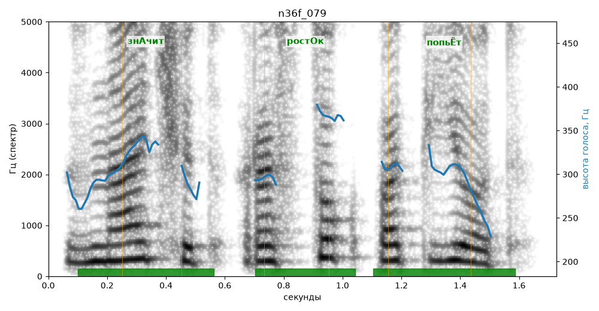

# n36f_079

Голос: **Филя, сборка 36d** · длительность 1.7 с
Эталон: Значит, росток попьёт?
Распознано: Значит, росток попьет.
Слова: все совпали

## Ударения
(где нужно: ruaccent)

| слово | нужно | у голоса | |
|---|---|---|---|
| значит | знАчит | знАчит | ✓ |
| росток | ростОк | ростОк | ✓ |
| попьёт | попьЁт | попьЁт | ✓ |

## Интонация
- ✓ «значит росток попьёт?» — вопросительный подъём на слове «росток»
- Диапазон голоса 5.9 полутонов (нормально), средняя высота 304 Гц

## Паузы и темп
- паузы на своих местах
- Темп 4.0 слога/с (нормально)

_Синяя линия — высота голоса. Над словами заглавная буква — где ударение должно быть; красным — голос поставил не туда (уверенно), оранжевым — возможно._
