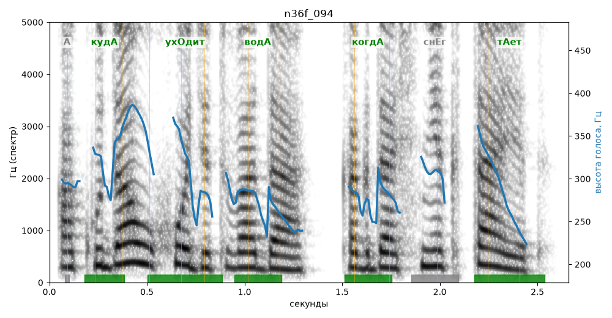

# n36f_094

Голос: **Филя, сборка 36d** · длительность 2.7 с
Эталон: А куда уходит вода, когда снег тает?
Распознано: А куда уходит вода, когда снег тает?
Слова: все совпали

## Ударения
(где нужно: ruaccent)

| слово | нужно | у голоса | |
|---|---|---|---|
| куда | кудА | кудА | ✓ |
| уходит | ухОдит | ухОдит | ✓ |
| вода | водА | водА | ✓ |
| когда | когдА | когдА | ✓ |
| тает | тАет | тАет | ✓ |

## Интонация
- ✗ «а куда уходит вода когда снег тает?» — нет вопросительного подъёма (самое высокое место — «куда», в начале) — звучит как утверждение
- Диапазон голоса 7.6 полутонов (живо), средняя высота 288 Гц

## Паузы и темп
- паузы на своих местах
- Темп 6.1 слога/с (нормально)

_Синяя линия — высота голоса. Над словами заглавная буква — где ударение должно быть; красным — голос поставил не туда (уверенно), оранжевым — возможно._
