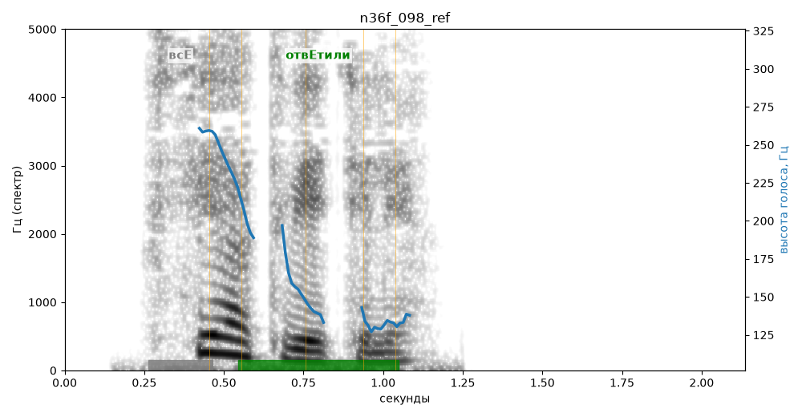

# n36f_098_ref

Голос: **edge:ru-RU-SvetlanaNeural** · длительность 2.1 с
Эталон: Все ответили!
Распознано: Все ответили.
Слова: все совпали

## Ударения
(где нужно: ruaccent)

| слово | нужно | у голоса | |
|---|---|---|---|
| ответили | отвЕтили | отвЕтили | ✓ |

## Интонация
- ✓ «все ответили!» — выделено слово «все» (+9.4 пт)
- Диапазон голоса 12.0 полутонов (живо), средняя высота 153 Гц

## Паузы и темп
- паузы на своих местах
- Темп 6.4 слога/с (нормально)

_Синяя линия — высота голоса. Над словами заглавная буква — где ударение должно быть; красным — голос поставил не туда (уверенно), оранжевым — возможно._
