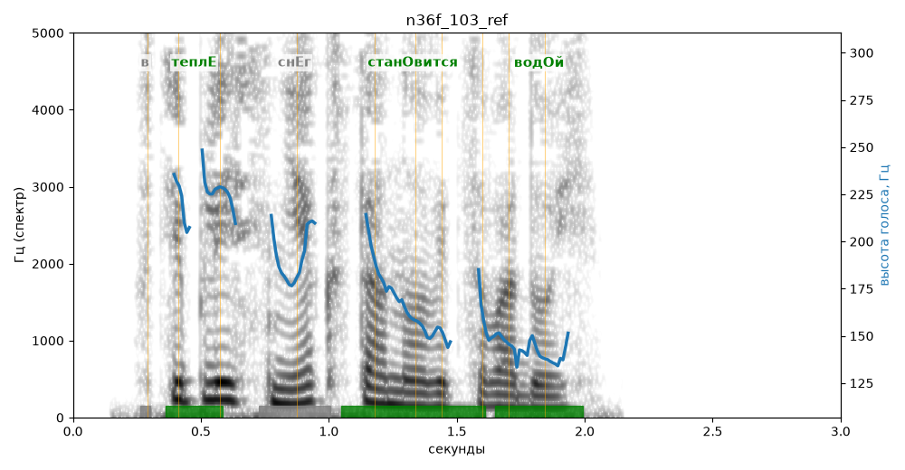

# n36f_103_ref

Голос: **edge:ru-RU-SvetlanaNeural** · длительность 3.0 с
Эталон: В тепле снег становится водой
Распознано: В тепле снег становится водой.
Слова: все совпали

## Ударения
(где нужно: ruaccent)

| слово | нужно | у голоса | |
|---|---|---|---|
| тепле | теплЕ | теплЕ | ✓ |
| становится | станОвится | станОвится | ✓ |
| водой | водОй | водОй | ✓ |

## Интонация
- ✓ «в тепле снег становится водой» — конец фразы понижается — звучит законченно
- Диапазон голоса 8.8 полутонов (живо), средняя высота 168 Гц

## Паузы и темп
- паузы на своих местах
- Темп 5.8 слога/с (нормально)

_Синяя линия — высота голоса. Над словами заглавная буква — где ударение должно быть; красным — голос поставил не туда (уверенно), оранжевым — возможно._
