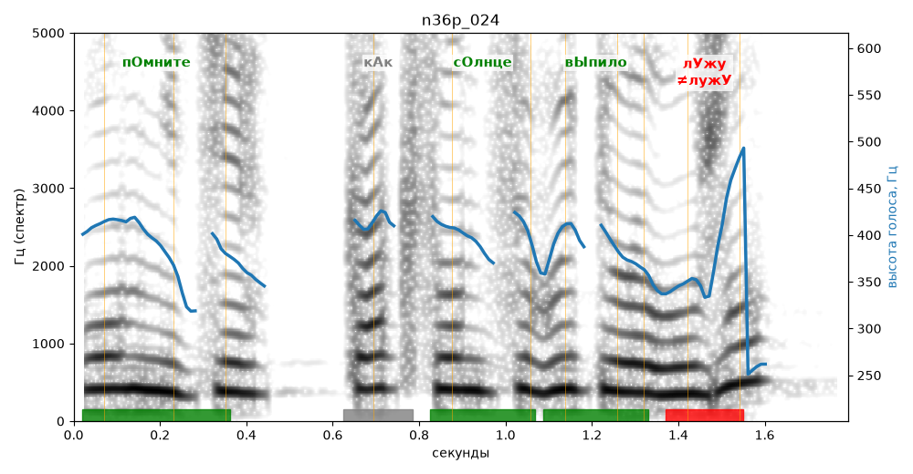

# n36p_024

Голос: **Пик, сборка 36d** · длительность 1.8 с
Эталон: Помните, как солнце выпило лужу?
Распознано: Помните, как он с собой тебя уже?
Расхождения в словах: «солнце выпило лужу» → «он с собой тебя уже»

## Ударения
(где нужно: ruaccent)

| слово | нужно | у голоса | |
|---|---|---|---|
| помните | пОмните | пОмните | ✓ |
| солнце | сОлнце | сОлнце | ✓ |
| выпило | вЫпило | вЫпило | ✓ |
| лужу | лУжу | лужУ | ✗ ОШИБКА |

## Интонация
- ✗ «помните как солнце выпило лужу?» — нет вопросительного подъёма (самое высокое место — «помните», в начале) — звучит как утверждение
- Диапазон голоса 4.9 полутонов (нормально), средняя высота 390 Гц

## Паузы и темп
- паузы на своих местах
- Темп 8.7 слога/с (быстро)

_Синяя линия — высота голоса. Над словами заглавная буква — где ударение должно быть; красным — голос поставил не туда (уверенно), оранжевым — возможно._
