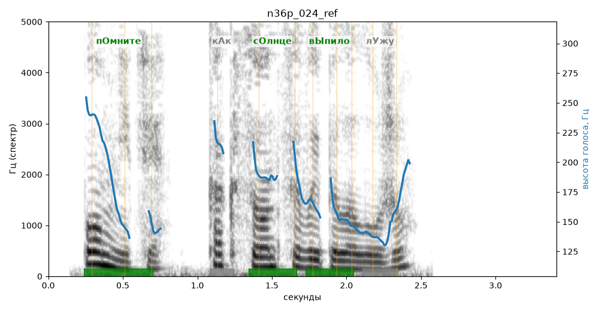

# n36p_024_ref

Голос: **edge:ru-RU-SvetlanaNeural** · длительность 3.4 с
Эталон: Помните, как солнце выпило лужу?
Распознано: Помните, как солнце выпила лужу?
Расхождения в словах: «выпило» → «выпила»

## Ударения
(где нужно: ruaccent)

| слово | нужно | у голоса | |
|---|---|---|---|
| помните | пОмните | пОмните | ✓ |
| солнце | сОлнце | сОлнце | ✓ |
| выпило | вЫпило | вЫпило | ✓ |
| лужу | лУжу | лужУ | ? не разобрать |

## Интонация
- ✗ «помните как солнце выпило лужу?» — нет вопросительного подъёма (самое высокое место — «помните», в начале) — звучит как утверждение
- Диапазон голоса 9.6 полутонов (живо), средняя высота 165 Гц

## Паузы и темп
- паузы на своих местах
- Темп 6.4 слога/с (нормально)

_Синяя линия — высота голоса. Над словами заглавная буква — где ударение должно быть; красным — голос поставил не туда (уверенно), оранжевым — возможно._
