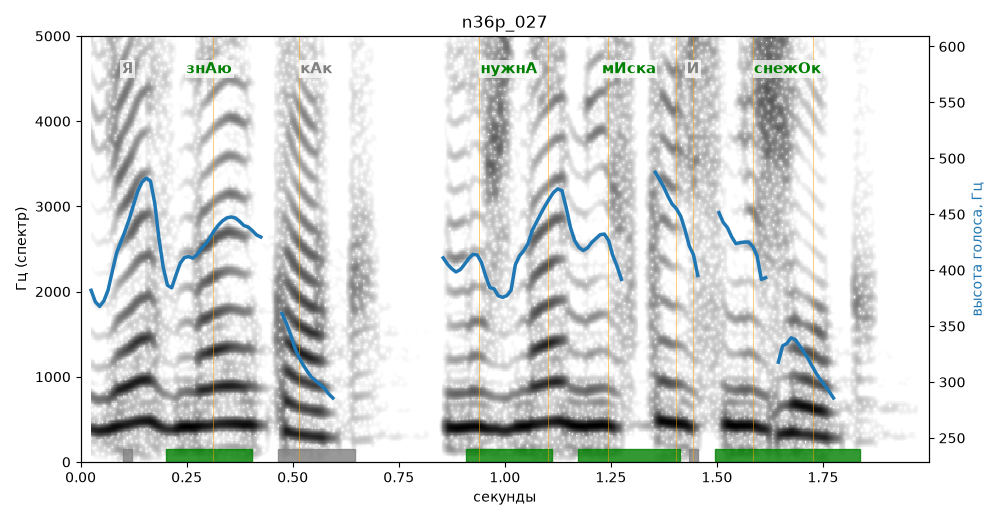

# n36p_027

Голос: **Пик, сборка 36d** · длительность 2.0 с
Эталон: Я знаю как. Нужна миска и снежок.
Распознано: Я знаю как, нужна миска снежок.
Расхождения в словах: «и» → «»

## Ударения
(где нужно: ruaccent)

| слово | нужно | у голоса | |
|---|---|---|---|
| знаю | знАю | знАю | ✓ |
| нужна | нужнА | нужнА | ✓ |
| миска | мИска | мИска | ✓ |
| снежок | снежОк | снежОк | ✓ |

## Интонация
- ✓ «нужна миска и снежок.» — конец фразы понижается — звучит законченно
- Диапазон голоса 7.8 полутонов (живо), средняя высота 414 Гц

## Паузы и темп
- паузы на своих местах
- Темп 6.1 слога/с (нормально)

_Синяя линия — высота голоса. Над словами заглавная буква — где ударение должно быть; красным — голос поставил не туда (уверенно), оранжевым — возможно._
