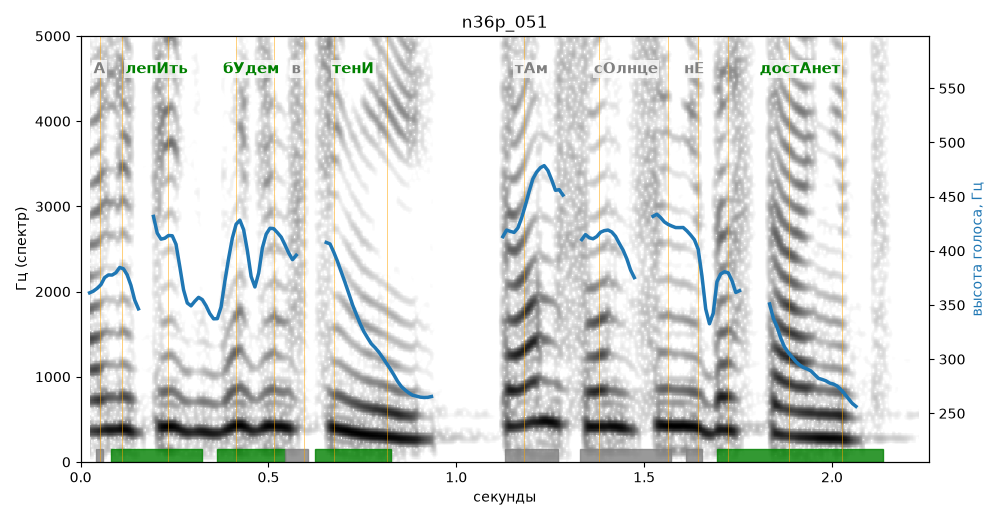

# n36p_051

Голос: **Пик, сборка 36d** · длительность 2.3 с
Эталон: А лепить будем в тени. Там солнце не достанет.
Распознано: А лететь будем скинии, там солнце не достанет.
Расхождения в словах: «лепить» → «лететь»; «в тени» → «скинии»

## Ударения
(где нужно: ruaccent)

| слово | нужно | у голоса | |
|---|---|---|---|
| лепить | лепИть | лепИть | ✓ |
| будем | бУдем | бУдем | ✓ |
| тени | тенИ | тенИ | ✓ |
| солнце | сОлнце | солнцЕ | ? не разобрать |
| достанет | достАнет | достАнет | ✓ |

## Интонация
- ✓ «а лепить будем в тени.» — конец фразы понижается — звучит законченно
- ✓ «там солнце не достанет.» — конец фразы понижается — звучит законченно
- Диапазон голоса 9.2 полутонов (живо), средняя высота 378 Гц

## Паузы и темп
- паузы на своих местах
- Темп 8.4 слога/с (быстро)

_Синяя линия — высота голоса. Над словами заглавная буква — где ударение должно быть; красным — голос поставил не туда (уверенно), оранжевым — возможно._
