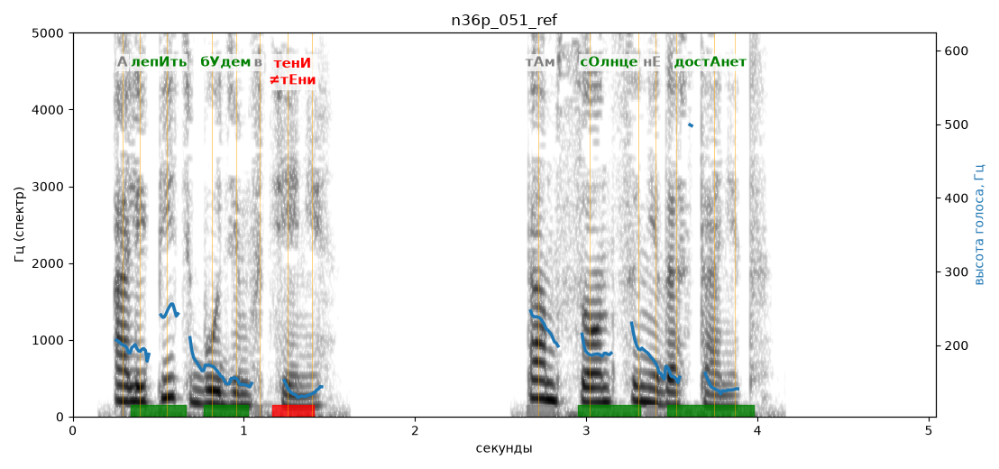

# n36p_051_ref

Голос: **edge:ru-RU-SvetlanaNeural** · длительность 5.0 с
Эталон: А лепить будем в тени. Там солнце не достанет.
Распознано: А лепить будем в тени. Там солнце не достанет.
Слова: все совпали

## Ударения
(где нужно: ruaccent)

| слово | нужно | у голоса | |
|---|---|---|---|
| лепить | лепИть | лепИть | ✓ |
| будем | бУдем | бУдем | ✓ |
| тени | тенИ | тЕни | ✗ ОШИБКА |
| солнце | сОлнце | сОлнце | ✓ |
| достанет | достАнет | достАнет | ✓ |

## Интонация
- ✓ «а лепить будем в тени.» — конец фразы понижается — звучит законченно
- ✓ «там солнце не достанет.» — конец фразы понижается — звучит законченно
- Диапазон голоса 10.4 полутонов (живо), средняя высота 173 Гц

## Паузы и темп
- паузы на своих местах
- Темп 6.1 слога/с (нормально)

_Синяя линия — высота голоса. Над словами заглавная буква — где ударение должно быть; красным — голос поставил не туда (уверенно), оранжевым — возможно._
