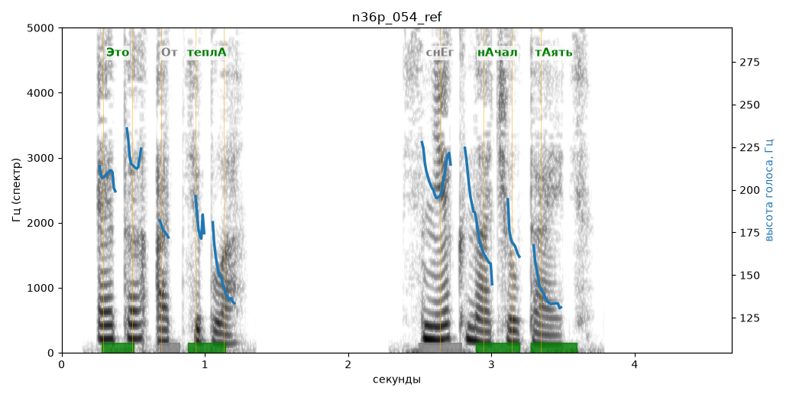

# n36p_054_ref

Голос: **edge:ru-RU-SvetlanaNeural** · длительность 4.7 с
Эталон: Это от тепла. Снег начал таять.
Распознано: Это от тепла. Снег начал таять.
Слова: все совпали

## Ударения
(где нужно: ruaccent)

| слово | нужно | у голоса | |
|---|---|---|---|
| это | Это | Это | ✓ |
| тепла | теплА | теплА | ✓ |
| начал | нАчал | нАчал | ✓ |
| таять | тАять | тАять | ✓ |

## Интонация
- ✓ «это от тепла.» — конец фразы понижается — звучит законченно
- ✓ «снег начал таять.» — конец фразы понижается — звучит законченно
- Диапазон голоса 8.8 полутонов (живо), средняя высота 177 Гц

## Паузы и темп
- паузы на своих местах
- Темп 5.0 слога/с (нормально)

_Синяя линия — высота голоса. Над словами заглавная буква — где ударение должно быть; красным — голос поставил не туда (уверенно), оранжевым — возможно._
