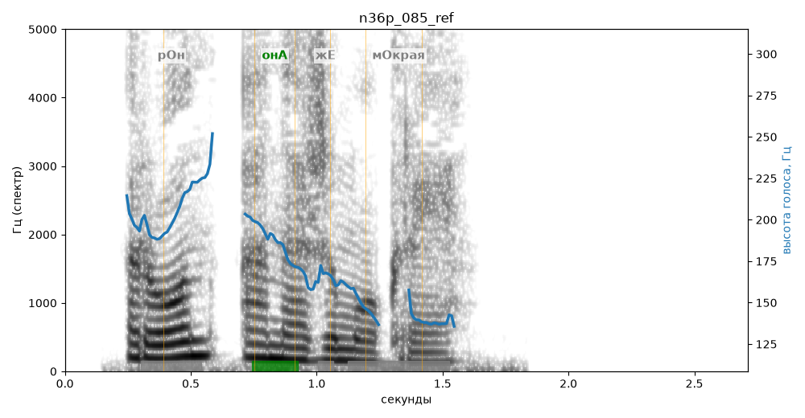

# n36p_085_ref

Голос: **edge:ru-RU-SvetlanaNeural** · длительность 2.7 с
Эталон: Рон, она же мокрая!
Распознано: Рон а нажимокре.
Расхождения в словах: «она же мокрая» → «а нажимокре»

## Ударения
(где нужно: ruaccent)

| слово | нужно | у голоса | |
|---|---|---|---|
| она | онА | онА | ✓ |
| мокрая | мОкрая | — | ? |

## Интонация
- ✓ «рон она же мокрая!» — выделено слово «рон» (+2.8 пт)
- Диапазон голоса 8.4 полутонов (живо), средняя высота 173 Гц

## Паузы и темп
- паузы на своих местах
- Темп 5.9 слога/с (нормально)

_Синяя линия — высота голоса. Над словами заглавная буква — где ударение должно быть; красным — голос поставил не туда (уверенно), оранжевым — возможно._
