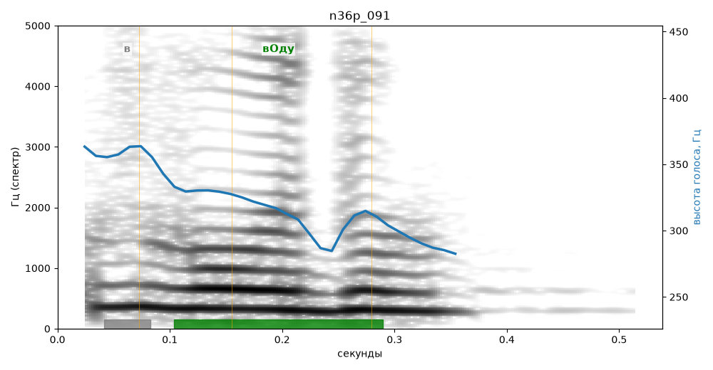

# n36p_091

Голос: **Пик, сборка 36d** · длительность 0.5 с
Эталон: В воду!
Распознано: его
Расхождения в словах: «в воду» → «его»

## Ударения
(где нужно: ruaccent)

| слово | нужно | у голоса | |
|---|---|---|---|
| воду | вОду | вОду | ✓ |

## Интонация
- ✗ «в воду!» — восклицание звучит ровно, без эмоции
- Диапазон голоса 4.2 полутонов (монотонно, как робот), средняя высота 318 Гц

## Паузы и темп
- паузы на своих местах
- Темп 12.1 слога/с (быстро)

_Синяя линия — высота голоса. Над словами заглавная буква — где ударение должно быть; красным — голос поставил не туда (уверенно), оранжевым — возможно._
