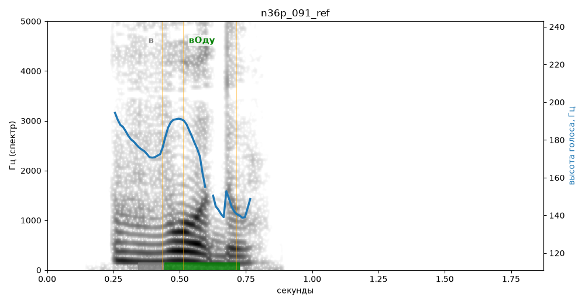

# n36p_091_ref

Голос: **edge:ru-RU-SvetlanaNeural** · длительность 1.9 с
Эталон: В воду!
Распознано: Воду
Расхождения в словах: «в» → «»

## Ударения
(где нужно: ruaccent)

| слово | нужно | у голоса | |
|---|---|---|---|
| воду | вОду | вОду | ✓ |

## Интонация
- ✗ «в воду!» — восклицание звучит ровно, без эмоции
- Диапазон голоса 5.4 полутонов (нормально), средняя высота 175 Гц

## Паузы и темп
- паузы на своих местах
- Темп 7.8 слога/с (быстро)

_Синяя линия — высота голоса. Над словами заглавная буква — где ударение должно быть; красным — голос поставил не туда (уверенно), оранжевым — возможно._
