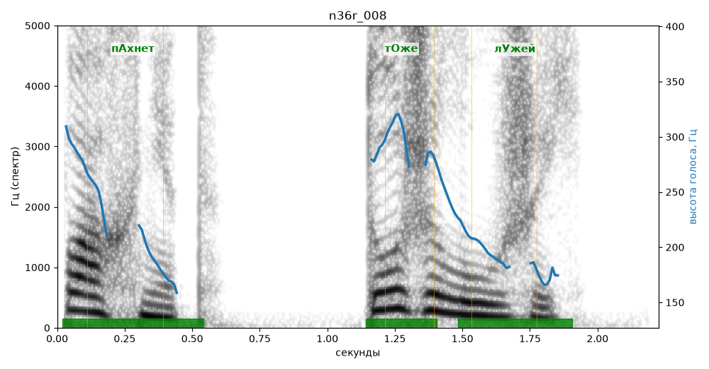

# n36r_008

Голос: **Рон, сборка 36d** · длительность 2.2 с
Эталон: Пахнет… тоже лужей.
Распознано: Пахнет. Тоже лужей.
Слова: все совпали

## Ударения
(где нужно: ruaccent)

| слово | нужно | у голоса | |
|---|---|---|---|
| пахнет | пАхнет | пАхнет | ✓ |
| тоже | тОже | тОже | ✓ |
| лужей | лУжей | лУжей | ✓ |

## Интонация
- ✓ «тоже лужей.» — конец фразы понижается — звучит законченно
- Диапазон голоса 10.5 полутонов (живо), средняя высота 220 Гц

## Паузы и темп
- паузы на своих местах
- Темп 4.7 слога/с (нормально)

_Синяя линия — высота голоса. Над словами заглавная буква — где ударение должно быть; красным — голос поставил не туда (уверенно), оранжевым — возможно._
