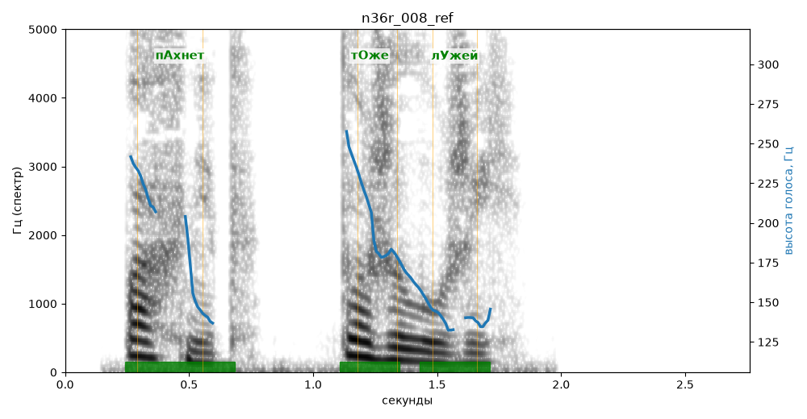

# n36r_008_ref

Голос: **edge:ru-RU-SvetlanaNeural** · длительность 2.8 с
Эталон: Пахнет… тоже лужей.
Распознано: Пахнет, тоже лужий.
Расхождения в словах: «лужей» → «лужий»

## Ударения
(где нужно: ruaccent)

| слово | нужно | у голоса | |
|---|---|---|---|
| пахнет | пАхнет | пАхнет | ✓ |
| тоже | тОже | тОже | ✓ |
| лужей | лУжей | лУжей | ✓ |

## Интонация
- ✓ «тоже лужей.» — конец фразы понижается — звучит законченно
- Диапазон голоса 10.0 полутонов (живо), средняя высота 168 Гц

## Паузы и темп
- паузы на своих местах
- Темп 5.7 слога/с (нормально)

_Синяя линия — высота голоса. Над словами заглавная буква — где ударение должно быть; красным — голос поставил не туда (уверенно), оранжевым — возможно._
