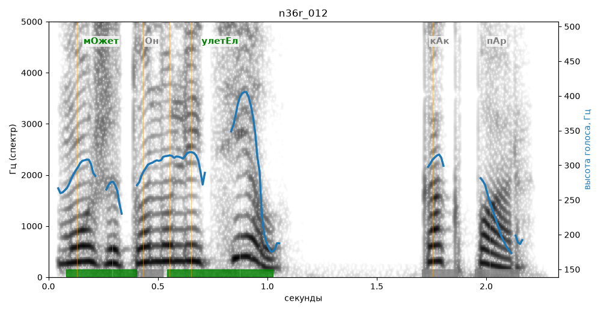

# n36r_012

Голос: **Рон, сборка 36d** · длительность 2.3 с
Эталон: Может, он улетел? Как пар?
Распознано: Может он улетел? Как пар?
Слова: все совпали

## Ударения
(где нужно: ruaccent)

| слово | нужно | у голоса | |
|---|---|---|---|
| может | мОжет | мОжет | ✓ |
| улетел | улетЕл | улетЕл | ✓ |

## Интонация
- ✓ «может он улетел?» — вопросительный подъём на слове «улетел»
- Диапазон голоса 13.1 полутонов (живо), средняя высота 292 Гц

## Паузы и темп
- после «может,» нет паузы (0.02 с)
- Темп 5.8 слога/с (нормально)

_Синяя линия — высота голоса. Над словами заглавная буква — где ударение должно быть; красным — голос поставил не туда (уверенно), оранжевым — возможно._
