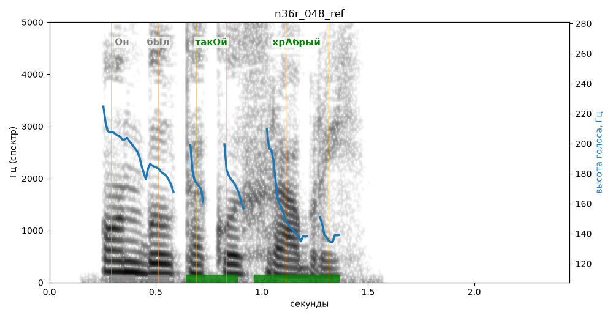

# n36r_048_ref

Голос: **edge:ru-RU-SvetlanaNeural** · длительность 2.4 с
Эталон: Он был такой храбрый.
Распознано: Он был такой храбрый.
Слова: все совпали

## Ударения
(где нужно: ruaccent)

| слово | нужно | у голоса | |
|---|---|---|---|
| такой | такОй | такОй | ✓ |
| храбрый | хрАбрый | хрАбрый | ✓ |

## Интонация
- ✓ «он был такой храбрый.» — конец фразы понижается — звучит законченно
- Диапазон голоса 7.1 полутонов (живо), средняя высота 176 Гц

## Паузы и темп
- паузы на своих местах
- Темп 5.5 слога/с (нормально)

_Синяя линия — высота голоса. Над словами заглавная буква — где ударение должно быть; красным — голос поставил не туда (уверенно), оранжевым — возможно._
