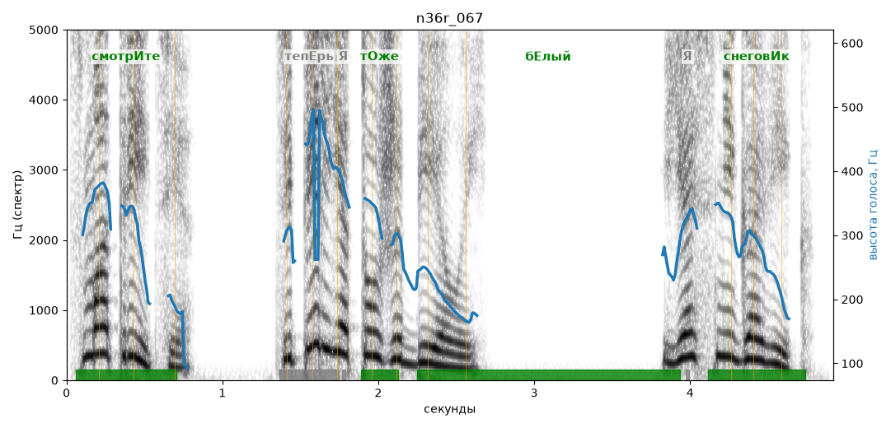

# n36r_067

Голос: **Рон, сборка 36d** · длительность 4.9 с
Эталон: Смотрите! Теперь я тоже белый! Я снеговик!
Распознано: Смотрите, теперь я тоже белый. Я снеговик.
Слова: все совпали

## Ударения
(где нужно: ruaccent)

| слово | нужно | у голоса | |
|---|---|---|---|
| смотрите | смотрИте | смотрИте | ✓ |
| теперь | тепЕрь | — | ? |
| тоже | тОже | тОже | ✓ |
| белый | бЕлый | бЕлый | ✓ |
| снеговик | снеговИк | снеговИк | ✓ |

## Интонация
- ✗ «смотрите!» — восклицание звучит ровно, без эмоции
- ✓ «теперь я тоже белый!» — выделено слово «теперь» (+7.1 пт)
- ✗ «я снеговик!» — восклицание звучит ровно, без эмоции
- Диапазон голоса 16.2 полутонов (живо), средняя высота 288 Гц

## Паузы и темп
- после «белый!» пауза всего 0.04 с — фразы слипаются
- Темп 3.2 слога/с (медленно)

_Синяя линия — высота голоса. Над словами заглавная буква — где ударение должно быть; красным — голос поставил не туда (уверенно), оранжевым — возможно._
