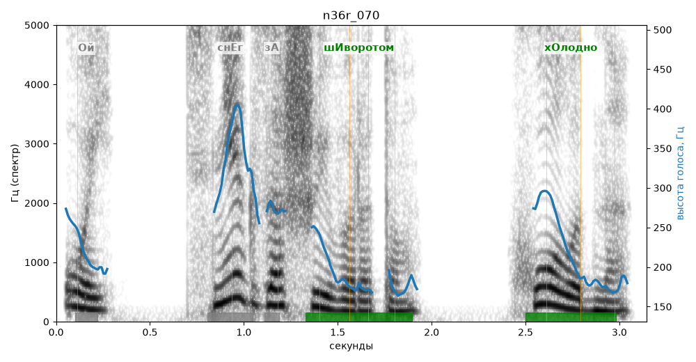

# n36r_070

Голос: **Рон, сборка 36d** · длительность 3.1 с
Эталон: Ой. Снег за шиворотом. Холодно!
Распознано: Ой, снег за шиворотом. Холодно.
Слова: все совпали

## Ударения
(где нужно: ruaccent)

| слово | нужно | у голоса | |
|---|---|---|---|
| шиворотом | шИворотом | шИворотом | ✓ |
| холодно | хОлодно | хОлодно | ✓ |

## Интонация
- ✗ «снег за шиворотом.» — конец фразы не понижается — звучит незаконченно / как перечисление
- ✓ «холодно!» — выделено слово «холодно» (+7.1 пт)
- Диапазон голоса 13.0 полутонов (живо), средняя высота 207 Гц

## Паузы и темп
- паузы на своих местах
- Темп 5.9 слога/с (нормально)

_Синяя линия — высота голоса. Над словами заглавная буква — где ударение должно быть; красным — голос поставил не туда (уверенно), оранжевым — возможно._
