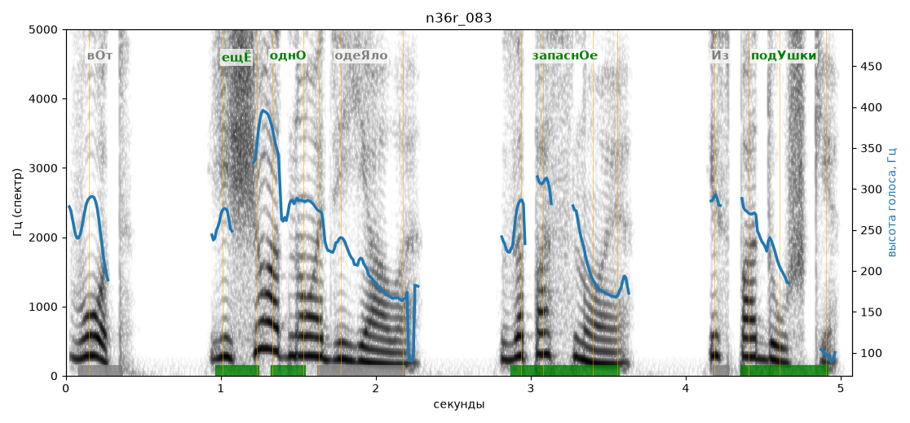

# n36r_083

Голос: **Рон, сборка 36d** · длительность 5.1 с
Эталон: Вот! Ещё одно одеяло. Запасное. Из подушки.
Распознано: Вот, еще одно одеяло, запасное из подушки.
Слова: все совпали

## Ударения
(где нужно: ruaccent)

| слово | нужно | у голоса | |
|---|---|---|---|
| ещё | ещЁ | ещЁ | ✓ |
| одно | однО | однО | ✓ |
| одеяло | одеЯло | — | ? |
| запасное | запаснОе | запаснОе | ✓ |
| подушки | подУшки | подУшки | ✓ |

## Интонация
- ✓ «ещё одно одеяло.» — конец фразы понижается — звучит законченно
- ✓ «запасное.» — конец фразы понижается — звучит законченно
- ✓ «из подушки.» — конец фразы понижается — звучит законченно
- Диапазон голоса 21.0 полутонов (живо), средняя высота 238 Гц

## Паузы и темп
- паузы на своих местах
- Темп 5.4 слога/с (нормально)

_Синяя линия — высота голоса. Над словами заглавная буква — где ударение должно быть; красным — голос поставил не туда (уверенно), оранжевым — возможно._
