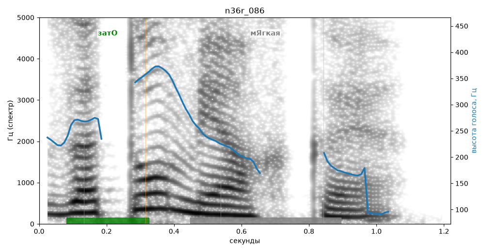

# n36r_086

Голос: **Рон, сборка 36d** · длительность 1.2 с
Эталон: Зато мягкая.
Распознано: Затумяхки.
Расхождения в словах: «зато мягкая» → «затумяхки»

## Ударения
(где нужно: ruaccent)

| слово | нужно | у голоса | |
|---|---|---|---|
| зато | затО | затО | ✓ |
| мягкая | мЯгкая | — | ? |

## Интонация
- ✓ «зато мягкая.» — конец фразы понижается — звучит законченно
- Диапазон голоса 23.5 полутонов (живо), средняя высота 230 Гц

## Паузы и темп
- паузы на своих местах
- Темп 4.9 слога/с (нормально)

_Синяя линия — высота голоса. Над словами заглавная буква — где ударение должно быть; красным — голос поставил не туда (уверенно), оранжевым — возможно._
