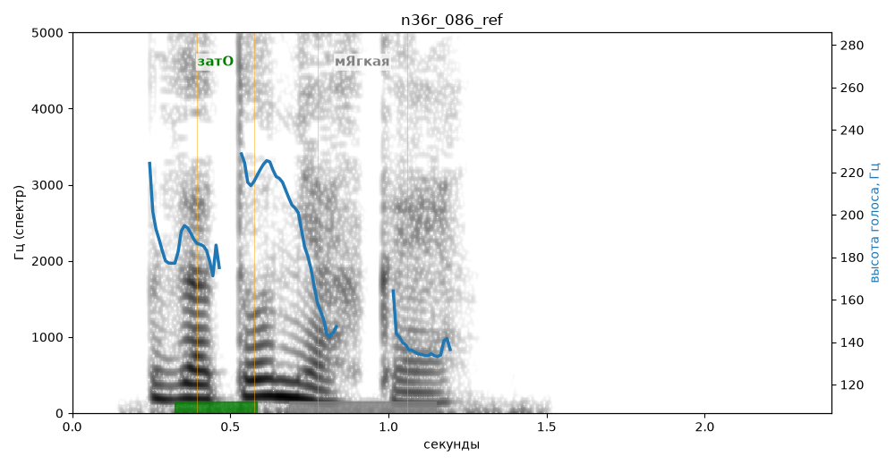

# n36r_086_ref

Голос: **edge:ru-RU-SvetlanaNeural** · длительность 2.4 с
Эталон: Зато мягкая.
Распознано: Затомяхка
Расхождения в словах: «зато мягкая» → «затомяхка»

## Ударения
(где нужно: ruaccent)

| слово | нужно | у голоса | |
|---|---|---|---|
| зато | затО | затО | ✓ |
| мягкая | мЯгкая | — | ? |

## Интонация
- ✓ «зато мягкая.» — конец фразы понижается — звучит законченно
- Диапазон голоса 8.9 полутонов (живо), средняя высота 182 Гц

## Паузы и темп
- паузы на своих местах
- Темп 4.8 слога/с (нормально)

_Синяя линия — высота голоса. Над словами заглавная буква — где ударение должно быть; красным — голос поставил не туда (уверенно), оранжевым — возможно._
