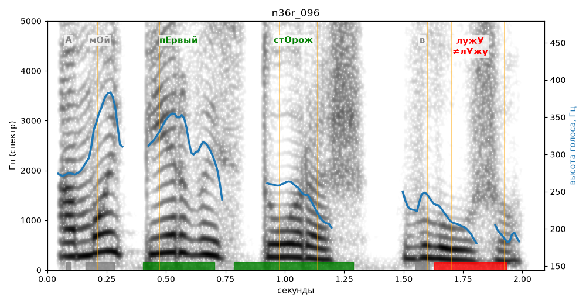

# n36r_096

Голос: **Рон, сборка 36d** · длительность 2.1 с
Эталон: А мой первый сторож — в лужу.
Распознано: А мой первый сторож в лужу.
Слова: все совпали

## Ударения
(где нужно: ruaccent)

| слово | нужно | у голоса | |
|---|---|---|---|
| первый | пЕрвый | пЕрвый | ✓ |
| сторож | стОрож | стОрож | ✓ |
| лужу | лужУ | лУжу | ✗ ОШИБКА |

## Интонация
- ✓ «а мой первый сторож в лужу.» — конец фразы понижается — звучит законченно
- Диапазон голоса 11.0 полутонов (живо), средняя высота 260 Гц

## Паузы и темп
- паузы на своих местах
- Темп 5.7 слога/с (нормально)

_Синяя линия — высота голоса. Над словами заглавная буква — где ударение должно быть; красным — голос поставил не туда (уверенно), оранжевым — возможно._
