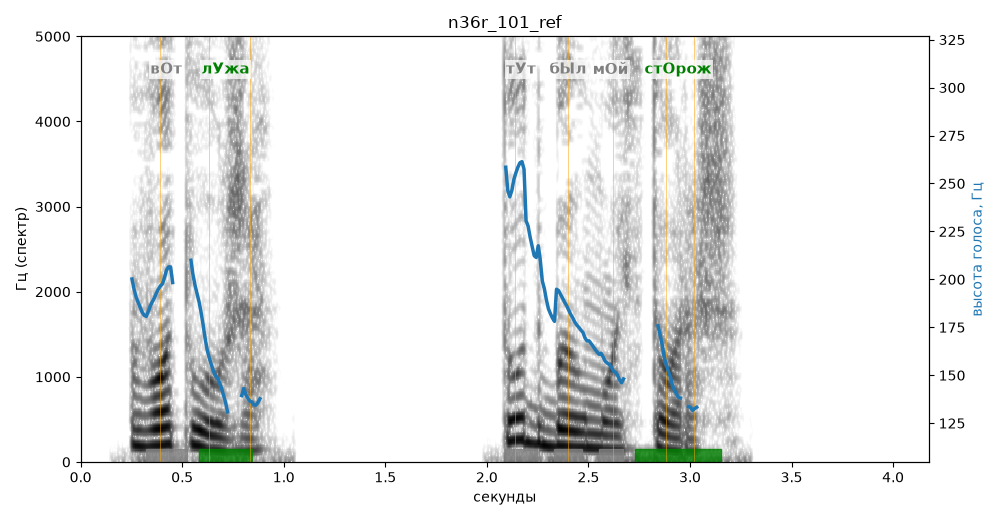

# n36r_101_ref

Голос: **edge:ru-RU-SvetlanaNeural** · длительность 4.2 с
Эталон: Вот лужа. Тут был мой сторож.
Распознано: Вот, Лужа. Тут был мой сторож.
Слова: все совпали

## Ударения
(где нужно: ruaccent)

| слово | нужно | у голоса | |
|---|---|---|---|
| лужа | лУжа | лУжа | ✓ |
| сторож | стОрож | стОрож | ✓ |

## Интонация
- ✗ «вот лужа.» — конец фразы не понижается — звучит незаконченно / как перечисление
- ✓ «тут был мой сторож.» — конец фразы понижается — звучит законченно
- Диапазон голоса 10.8 полутонов (живо), средняя высота 176 Гц

## Паузы и темп
- паузы на своих местах
- Темп 5.0 слога/с (нормально)

_Синяя линия — высота голоса. Над словами заглавная буква — где ударение должно быть; красным — голос поставил не туда (уверенно), оранжевым — возможно._
