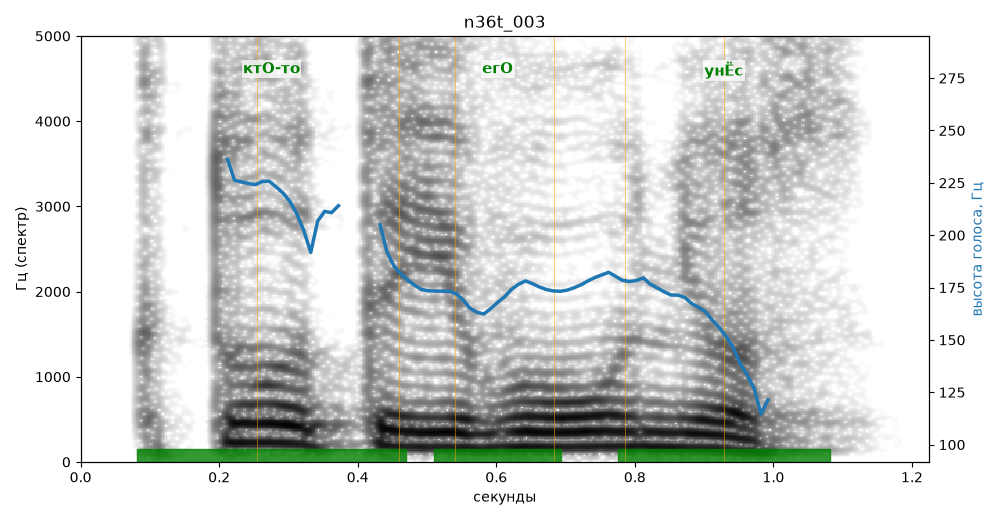

# n36t_003

Голос: **Топа, сборка 36d** · длительность 1.2 с
Эталон: Кто-то его унёс?
Распознано: кто-то его унес.
Слова: все совпали

## Ударения
(где нужно: ruaccent)

| слово | нужно | у голоса | |
|---|---|---|---|
| кто-то | ктО-то | ктО-то | ✓ |
| его | егО | егО | ✓ |
| унёс | унЁс | унЁс | ✓ |

## Интонация
- ✗ «кто-то его унёс?» — нет вопросительного подъёма (самое высокое место — «кто-то», в начале) — звучит как утверждение
- Диапазон голоса 8.7 полутонов (живо), средняя высота 176 Гц

## Паузы и темп
- паузы на своих местах
- Темп 6.0 слога/с (нормально)

_Синяя линия — высота голоса. Над словами заглавная буква — где ударение должно быть; красным — голос поставил не туда (уверенно), оранжевым — возможно._
