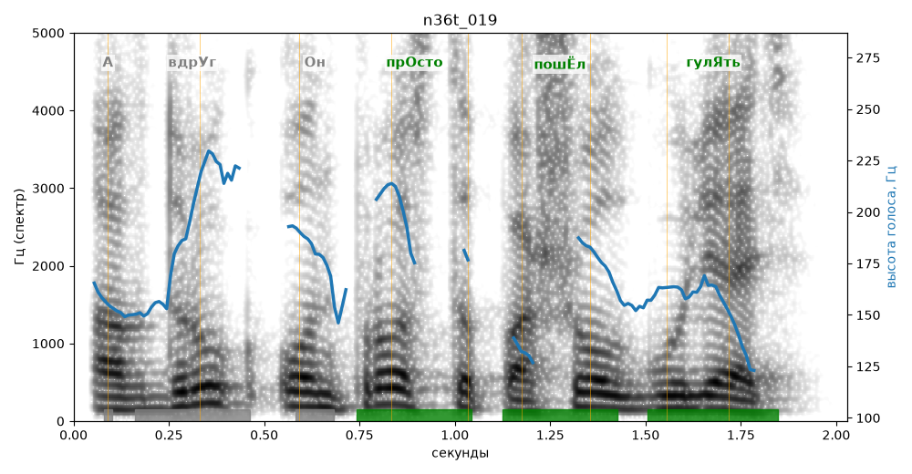

# n36t_019

Голос: **Топа, сборка 36d** · длительность 2.0 с
Эталон: А вдруг он просто пошёл гулять?
Распознано: а вдруг он просто пошел гулять.
Слова: все совпали

## Ударения
(где нужно: ruaccent)

| слово | нужно | у голоса | |
|---|---|---|---|
| просто | прОсто | прОсто | ✓ |
| пошёл | пошЁл | пошЁл | ✓ |
| гулять | гулЯть | гулЯть | ✓ |

## Интонация
- ✓ «а вдруг он просто пошёл гулять?» — вопросительный подъём на слове «вдруг»
- Диапазон голоса 8.9 полутонов (живо), средняя высота 164 Гц

## Паузы и темп
- паузы на своих местах
- Темп 5.1 слога/с (нормально)

_Синяя линия — высота голоса. Над словами заглавная буква — где ударение должно быть; красным — голос поставил не туда (уверенно), оранжевым — возможно._
