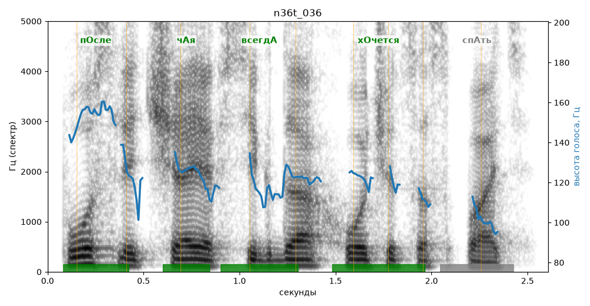

# n36t_036

Голос: **Топа, сборка 36d** · длительность 2.6 с
Эталон: После чая всегда хочется спать.
Распознано: После чая всегда хочется спать.
Слова: все совпали

## Ударения
(где нужно: ruaccent)

| слово | нужно | у голоса | |
|---|---|---|---|
| после | пОсле | пОсле | ✓ |
| чая | чАя | чАя | ✓ |
| всегда | всегдА | всегдА | ✓ |
| хочется | хОчется | хОчется | ✓ |

## Интонация
- ✓ «после чая всегда хочется спать.» — конец фразы понижается — звучит законченно
- Диапазон голоса 7.7 полутонов (живо), средняя высота 122 Гц

## Паузы и темп
- паузы на своих местах
- Темп 4.5 слога/с (нормально)

_Синяя линия — высота голоса. Над словами заглавная буква — где ударение должно быть; красным — голос поставил не туда (уверенно), оранжевым — возможно._
