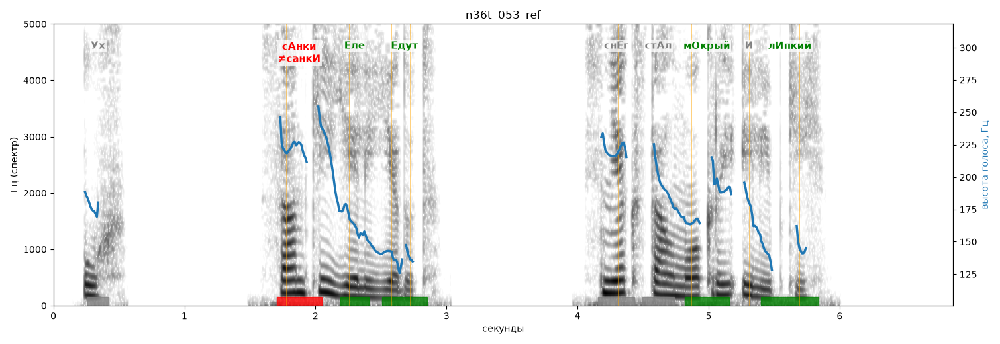

# n36t_053_ref

Голос: **edge:ru-RU-SvetlanaNeural** · длительность 6.9 с
Эталон: Ух! Санки еле едут. Снег стал мокрый и липкий.
Распознано: Ух! Санки ели едут. Снек стал мокрый и либкий.
Расхождения в словах: «еле» → «ели»; «снег» → «снек»; «липкий» → «либкий»

## Ударения
(где нужно: ruaccent)

| слово | нужно | у голоса | |
|---|---|---|---|
| санки | сАнки | санкИ | ✗ ОШИБКА |
| еле | Еле | Еле | ✓ |
| едут | Едут | Едут | ✓ |
| мокрый | мОкрый | мОкрый | ✓ |
| липкий | лИпкий | лИпкий | ✓ |

## Интонация
- ✓ «санки еле едут.» — конец фразы понижается — звучит законченно
- ✓ «снег стал мокрый и липкий.» — конец фразы понижается — звучит законченно
- Диапазон голоса 8.8 полутонов (живо), средняя высота 177 Гц

## Паузы и темп
- паузы на своих местах
- Темп 4.7 слога/с (нормально)

_Синяя линия — высота голоса. Над словами заглавная буква — где ударение должно быть; красным — голос поставил не туда (уверенно), оранжевым — возможно._
