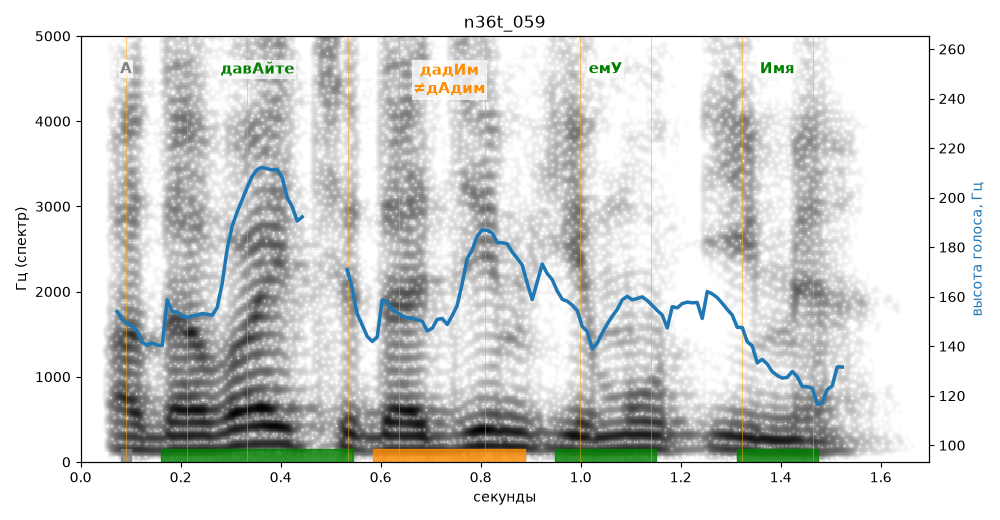

# n36t_059

Голос: **Топа, сборка 36d** · длительность 1.7 с
Эталон: А давайте дадим ему имя.
Распознано: А давайте дадим ему имя.
Слова: все совпали

## Ударения
(где нужно: ruaccent)

| слово | нужно | у голоса | |
|---|---|---|---|
| давайте | давАйте | давАйте | ✓ |
| дадим | дадИм | дАдим | ✗? возможно — послушать |
| ему | емУ | емУ | ✓ |
| имя | Имя | Имя | ✓ |

## Интонация
- ✓ «а давайте дадим ему имя.» — конец фразы понижается — звучит законченно
- Диапазон голоса 8.3 полутонов (живо), средняя высота 154 Гц

## Паузы и темп
- паузы на своих местах
- Темп 8.1 слога/с (быстро)

_Синяя линия — высота голоса. Над словами заглавная буква — где ударение должно быть; красным — голос поставил не туда (уверенно), оранжевым — возможно._
