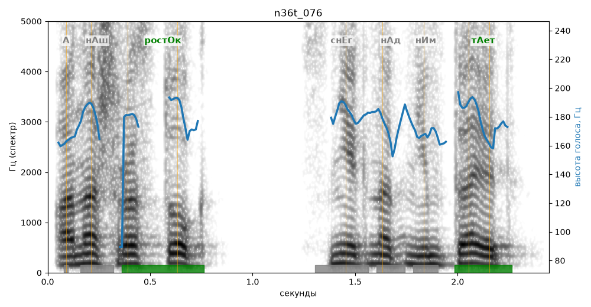

# n36t_076

Голос: **Топа, сборка 36d** · длительность 2.4 с
Эталон: А наш росток? Снег над ним тает!
Распознано: А наш росток снег над ним тает.
Слова: все совпали

## Ударения
(где нужно: ruaccent)

| слово | нужно | у голоса | |
|---|---|---|---|
| росток | ростОк | ростОк | ✓ |
| тает | тАет | тАет | ✓ |

## Интонация
- ✗ «а наш росток?» — нет вопросительного подъёма (самое высокое место — «наш», в начале) — звучит как утверждение
- ✗ «снег над ним тает!» — восклицание звучит ровно, без эмоции
- Диапазон голоса 3.2 полутонов (монотонно, как робот), средняя высота 177 Гц

## Паузы и темп
- паузы на своих местах
- Темп 5.5 слога/с (нормально)

_Синяя линия — высота голоса. Над словами заглавная буква — где ударение должно быть; красным — голос поставил не туда (уверенно), оранжевым — возможно._
