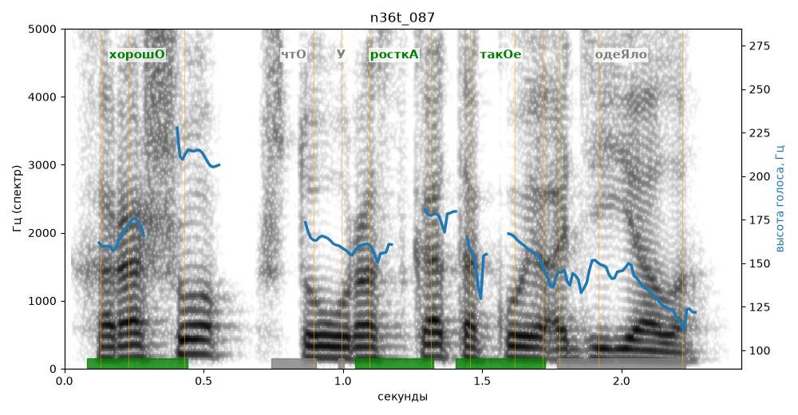

# n36t_087

Голос: **Топа, сборка 36d** · длительность 2.4 с
Эталон: Хорошо, что у ростка такое одеяло.
Распознано: Хорошо, что уростка такое одеяло.
Расхождения в словах: «у ростка» → «уростка»

## Ударения
(где нужно: ruaccent)

| слово | нужно | у голоса | |
|---|---|---|---|
| хорошо | хорошО | хорошО | ✓ |
| ростка | росткА | росткА | ✓ |
| такое | такОе | такОе | ✓ |
| одеяло | одеЯло | — | ? |

## Интонация
- ✓ «хорошо что у ростка такое одеяло.» — конец фразы понижается — звучит законченно
- Диапазон голоса 9.3 полутонов (живо), средняя высота 158 Гц

## Паузы и темп
- паузы на своих местах
- Темп 7.0 слога/с (быстро)

_Синяя линия — высота голоса. Над словами заглавная буква — где ударение должно быть; красным — голос поставил не туда (уверенно), оранжевым — возможно._
