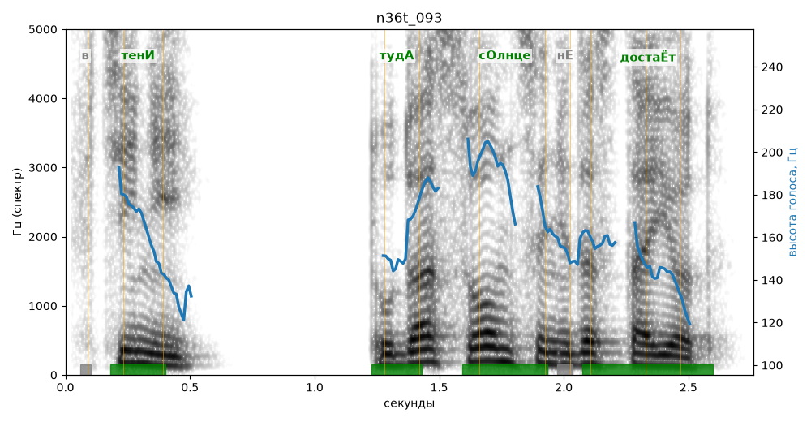

# n36t_093

Голос: **Топа, сборка 36d** · длительность 2.8 с
Эталон: В тени. Туда солнце не достаёт.
Распознано: Втени, туда солнце не достает.
Расхождения в словах: «в тени» → «втени»

## Ударения
(где нужно: ruaccent)

| слово | нужно | у голоса | |
|---|---|---|---|
| тени | тенИ | тенИ | ✓ |
| туда | тудА | тудА | ✓ |
| солнце | сОлнце | сОлнце | ✓ |
| достаёт | достаЁт | достаЁт | ✓ |

## Интонация
- ✓ «туда солнце не достаёт.» — конец фразы понижается — звучит законченно
- Диапазон голоса 7.1 полутонов (живо), средняя высота 158 Гц

## Паузы и темп
- паузы на своих местах
- Темп 7.1 слога/с (быстро)

_Синяя линия — высота голоса. Над словами заглавная буква — где ударение должно быть; красным — голос поставил не туда (уверенно), оранжевым — возможно._
