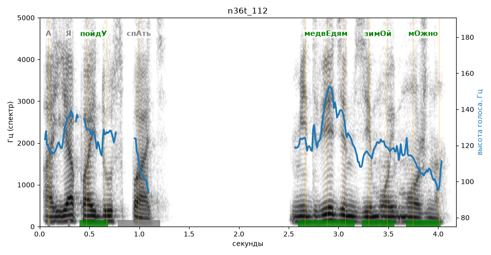

# n36t_112

Голос: **Топа, сборка 36d** · длительность 4.2 с
Эталон: А я пойду спать. Медведям зимой можно.
Распознано: А я пойду спать. Медведем зимой можно.
Расхождения в словах: «медведям» → «медведем»

## Ударения
(где нужно: ruaccent)

| слово | нужно | у голоса | |
|---|---|---|---|
| пойду | пойдУ | пойдУ | ✓ |
| медведям | медвЕдям | медвЕдям | ✓ |
| зимой | зимОй | зимОй | ✓ |
| можно | мОжно | мОжно | ✓ |

## Интонация
- ✓ «а я пойду спать.» — конец фразы понижается — звучит законченно
- ✓ «медведям зимой можно.» — конец фразы понижается — звучит законченно
- Диапазон голоса 5.6 полутонов (нормально), средняя высота 120 Гц

## Паузы и темп
- паузы на своих местах
- Темп 4.6 слога/с (нормально)

_Синяя линия — высота голоса. Над словами заглавная буква — где ударение должно быть; красным — голос поставил не туда (уверенно), оранжевым — возможно._
