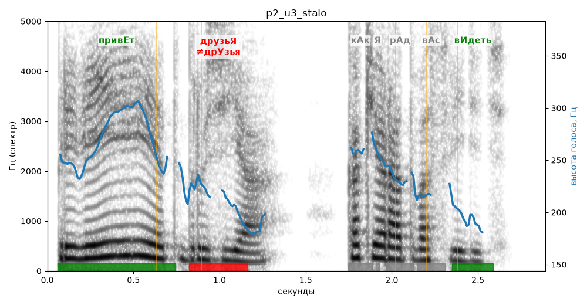

# p2_u3_stalo

Естественность (UTMOS): **3.2 из 5** (живой диктор ≈ 4–4.5)
Эталон: Привет, друзья! Как я рад вас видеть!
Распознано: Привет, друзья! Как я рад вас видеть!
Слова: все совпали

## Ударения
(где нужно: ruaccent)

| слово | нужно | у голоса | |
|---|---|---|---|
| привет | привЕт | привЕт | ✓ |
| друзья | друзьЯ | дрУзья | ✗ ОШИБКА |
| видеть | вИдеть | вИдеть | ✓ |

## Интонация
- ✗ «привет друзья!» — восклицание звучит ровно, без эмоции
- ✓ «как я рад вас видеть!» — выделено слово «как» (+3.2 пт)
- Диапазон голоса 8.6 полутонов (живо), средняя высота 236 Гц

## Паузы и темп
- паузы на своих местах
- Темп 4.1 слога/с (нормально)

_Синяя линия — высота голоса. Над словами заглавная буква — где ударение должно быть; красным — голос поставил не туда (уверенно), оранжевым — возможно._
