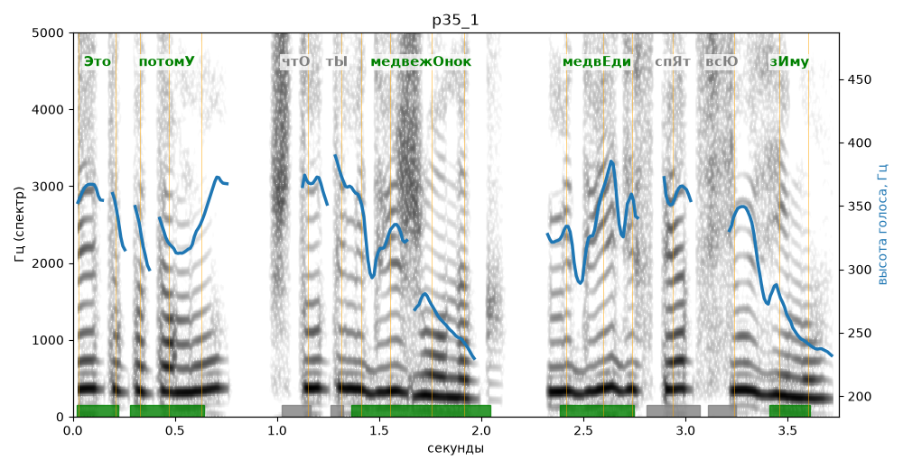

# p35_1

Голос: **Mac Milena** · длительность 3.8 с
Естественность (UTMOS): **2.56 из 5** (живой диктор ≈ 4–4.5)
Эталон: Это потому, что ты медвежонок. Медведи спят всю зиму!
Распознано: Это потому, что ты медвежонок. Медведи спят всю зиму.
Слова: все совпали

## Ударения
(где нужно: ruaccent)

| слово | нужно | у голоса | |
|---|---|---|---|
| это | Это | Это | ✓ |
| потому | потомУ | потомУ | ✓ |
| медвежонок | медвежОнок | медвежОнок | ✓ |
| медведи | медвЕди | медвЕди | ✓ |
| зиму | зИму | зИму | ✓ |

## Интонация
- ✓ «это потому что ты медвежонок.» — конец фразы понижается — звучит законченно
- ✗ «медведи спят всю зиму!» — восклицание звучит ровно, без эмоции
- Диапазон голоса 7.7 полутонов (живо), средняя высота 328 Гц

## Паузы и темп
- паузы на своих местах
- Темп 6.6 слога/с (быстро)

_Синяя линия — высота голоса. Над словами заглавная буква — где ударение должно быть; красным — голос поставил не туда (уверенно), оранжевым — возможно._
