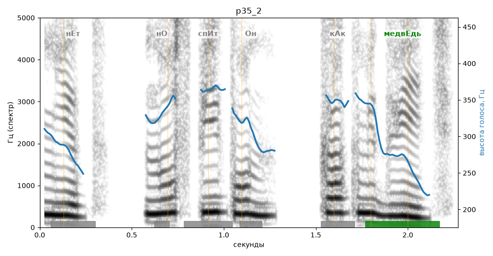

# p35_2

Голос: **Mac Milena** · длительность 2.3 с
Естественность (UTMOS): **2.7 из 5** (живой диктор ≈ 4–4.5)
Эталон: Нет. Но спит он, как медведь.
Распознано: Нет, но спит он, как медведь.
Слова: все совпали

## Ударения
(где нужно: ruaccent)

| слово | нужно | у голоса | |
|---|---|---|---|
| медведь | медвЕдь | медвЕдь | ✓ |

## Интонация
- ✓ «но спит он как медведь.» — конец фразы понижается — звучит законченно
- Диапазон голоса 7.2 полутонов (живо), средняя высота 318 Гц

## Паузы и темп
- паузы на своих местах
- Темп 4.8 слога/с (нормально)

_Синяя линия — высота голоса. Над словами заглавная буква — где ударение должно быть; красным — голос поставил не туда (уверенно), оранжевым — возможно._
