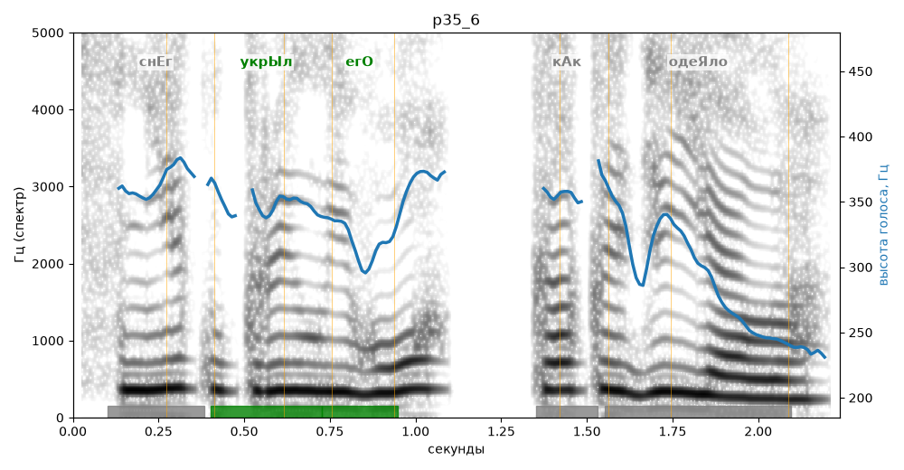

# p35_6

Голос: **Mac Milena** · длительность 2.2 с
Естественность (UTMOS): **2.8 из 5** (живой диктор ≈ 4–4.5)
Эталон: Снег укрыл его, как одеяло.
Распознано: Снег укрыл его, как одеяло.
Слова: все совпали

## Ударения
(где нужно: ruaccent)

| слово | нужно | у голоса | |
|---|---|---|---|
| укрыл | укрЫл | укрЫл | ✓ |
| его | егО | егО | ✓ |
| одеяло | одеЯло | — | ? |

## Интонация
- ✓ «снег укрыл его как одеяло.» — конец фразы понижается — звучит законченно
- Диапазон голоса 7.7 полутонов (живо), средняя высота 339 Гц

## Паузы и темп
- паузы на своих местах
- Темп 5.7 слога/с (нормально)

_Синяя линия — высота голоса. Над словами заглавная буква — где ударение должно быть; красным — голос поставил не туда (уверенно), оранжевым — возможно._
