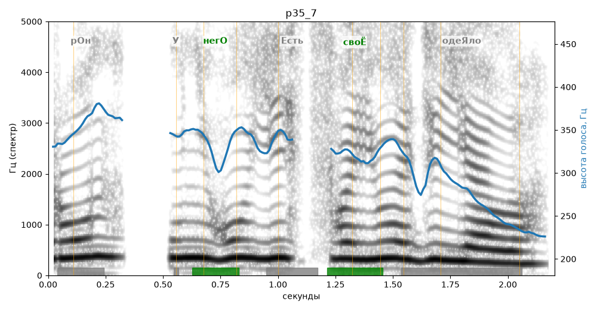

# p35_7

Голос: **Mac Milena** · длительность 2.2 с
Естественность (UTMOS): **2.33 из 5** (живой диктор ≈ 4–4.5)
Эталон: Рон, у него есть своё одеяло.
Распознано: у него есть свое одеяло.
Расхождения в словах: «рон» → «»

## Ударения
(где нужно: ruaccent)

| слово | нужно | у голоса | |
|---|---|---|---|
| него | негО | негО | ✓ |
| своё | своЁ | своЁ | ✓ |
| одеяло | одеЯло | — | ? |

## Интонация
- ✓ «рон у него есть своё одеяло.» — конец фразы понижается — звучит законченно
- Диапазон голоса 8.0 полутонов (живо), средняя высота 325 Гц

## Паузы и темп
- паузы на своих местах
- Темп 5.8 слога/с (нормально)

_Синяя линия — высота голоса. Над словами заглавная буква — где ударение должно быть; красным — голос поставил не туда (уверенно), оранжевым — возможно._
