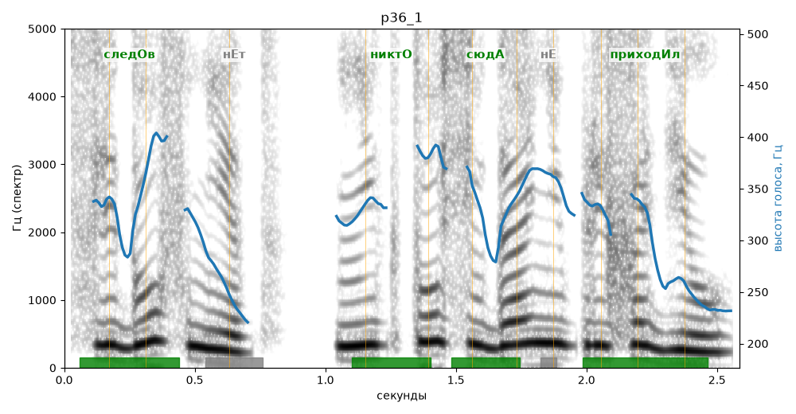

# p36_1

Голос: **Mac Milena** · длительность 2.6 с
Естественность (UTMOS): **2.35 из 5** (живой диктор ≈ 4–4.5)
Эталон: Следов нет. Никто сюда не приходил.
Распознано: Следов нет, никто сюда не приходил.
Слова: все совпали

## Ударения
(где нужно: ruaccent)

| слово | нужно | у голоса | |
|---|---|---|---|
| следов | следОв | следОв | ✓ |
| никто | никтО | никтО | ✓ |
| сюда | сюдА | сюдА | ✓ |
| приходил | приходИл | приходИл | ✓ |

## Интонация
- ✓ «следов нет.» — конец фразы понижается — звучит законченно
- ✓ «никто сюда не приходил.» — конец фразы понижается — звучит законченно
- Диапазон голоса 9.0 полутонов (живо), средняя высота 328 Гц

## Паузы и темп
- паузы на своих местах
- Темп 5.3 слога/с (нормально)

_Синяя линия — высота голоса. Над словами заглавная буква — где ударение должно быть; красным — голос поставил не туда (уверенно), оранжевым — возможно._
