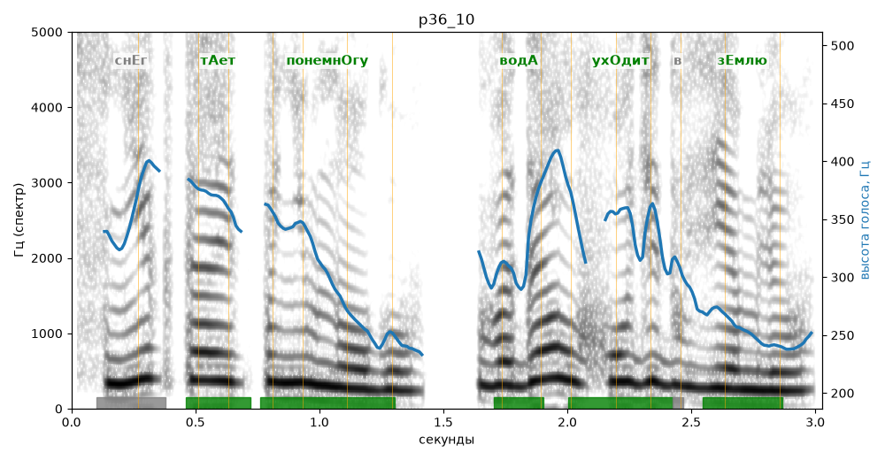

# p36_10

Голос: **Mac Milena** · длительность 3.0 с
Естественность (UTMOS): **2.59 из 5** (живой диктор ≈ 4–4.5)
Эталон: Снег тает понемногу. Вода уходит в землю.
Распознано: Снег тает понемногу, вода уходит в землю.
Слова: все совпали

## Ударения
(где нужно: ruaccent)

| слово | нужно | у голоса | |
|---|---|---|---|
| тает | тАет | тАет | ✓ |
| понемногу | понемнОгу | понемнОгу | ✓ |
| вода | водА | водА | ✓ |
| уходит | ухОдит | ухОдит | ✓ |
| землю | зЕмлю | зЕмлю | ✓ |

## Интонация
- ✓ «снег тает понемногу.» — конец фразы понижается — звучит законченно
- ✓ «вода уходит в землю.» — конец фразы понижается — звучит законченно
- Диапазон голоса 8.6 полутонов (живо), средняя высота 314 Гц

## Паузы и темп
- паузы на своих местах
- Темп 6.3 слога/с (нормально)

_Синяя линия — высота голоса. Над словами заглавная буква — где ударение должно быть; красным — голос поставил не туда (уверенно), оранжевым — возможно._
