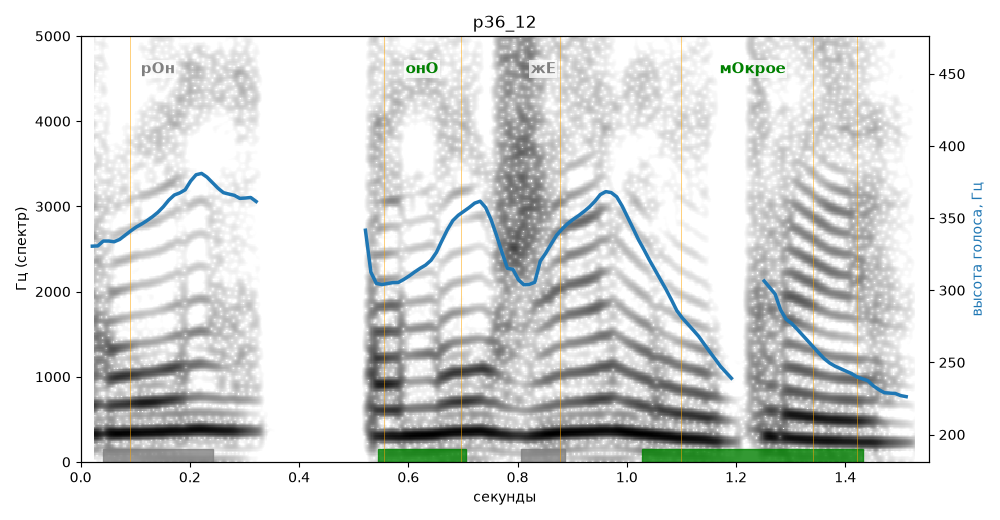

# p36_12

Голос: **Mac Milena** · длительность 1.6 с
Естественность (UTMOS): **2.56 из 5** (живой диктор ≈ 4–4.5)
Эталон: Рон, оно же мокрое!
Распознано: Оно уже мутрое.
Расхождения в словах: «рон» → «»; «же мокрое» → «уже мутрое»

## Ударения
(где нужно: ruaccent)

| слово | нужно | у голоса | |
|---|---|---|---|
| оно | онО | онО | ✓ |
| мокрое | мОкрое | мОкрое | ✓ |

## Интонация
- ✓ «рон оно же мокрое!» — выделено слово «рон» (+2.0 пт)
- Диапазон голоса 7.9 полутонов (живо), средняя высота 326 Гц

## Паузы и темп
- паузы на своих местах
- Темп 6.4 слога/с (нормально)

_Синяя линия — высота голоса. Над словами заглавная буква — где ударение должно быть; красным — голос поставил не туда (уверенно), оранжевым — возможно._
