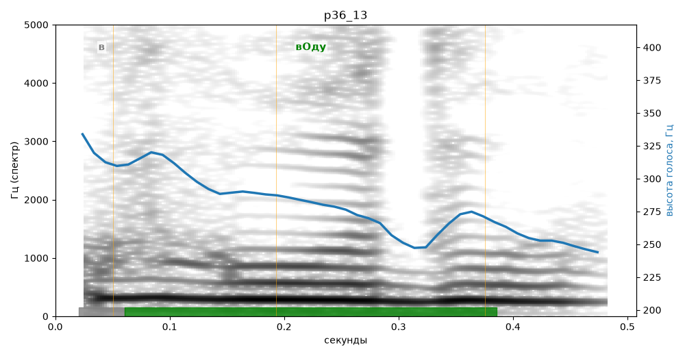

# p36_13

Голос: **Mac Milena** · длительность 0.5 с
Естественность (UTMOS): **1.4 из 5** (живой диктор ≈ 4–4.5)
Эталон: В воду!
Распознано: Воду.
Расхождения в словах: «в» → «»

## Ударения
(где нужно: ruaccent)

| слово | нужно | у голоса | |
|---|---|---|---|
| воду | вОду | вОду | ✓ |

## Интонация
- ✗ «в воду!» — восклицание звучит ровно, без эмоции
- Диапазон голоса 4.4 полутонов (монотонно, как робот), средняя высота 278 Гц

## Паузы и темп
- паузы на своих местах
- Темп 8.2 слога/с (быстро)

_Синяя линия — высота голоса. Над словами заглавная буква — где ударение должно быть; красным — голос поставил не туда (уверенно), оранжевым — возможно._
