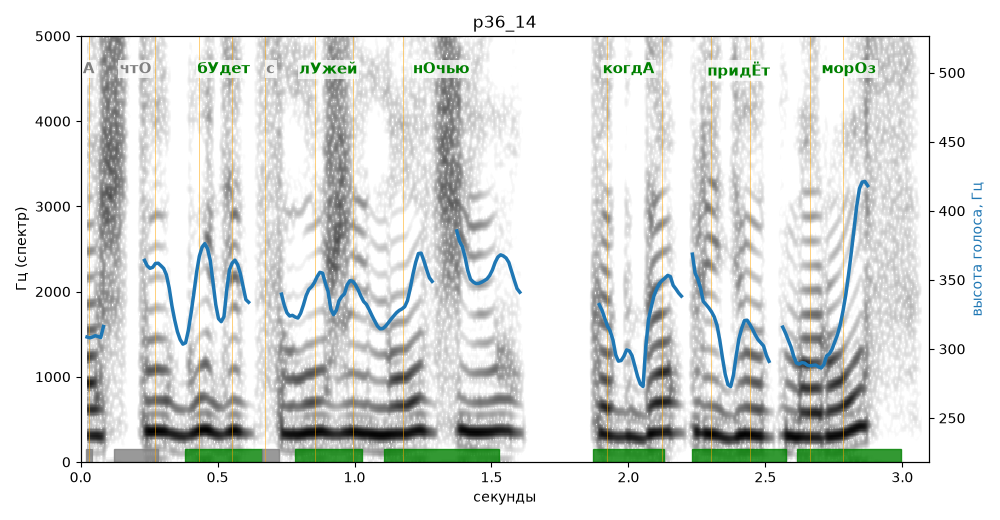

# p36_14

Голос: **Mac Milena** · длительность 3.1 с
Естественность (UTMOS): **2.37 из 5** (живой диктор ≈ 4–4.5)
Эталон: А что будет с лужей ночью, когда придёт мороз?
Распознано: А что будет с лужей ночью, когда придет мороз?
Слова: все совпали

## Ударения
(где нужно: ruaccent)

| слово | нужно | у голоса | |
|---|---|---|---|
| будет | бУдет | бУдет | ✓ |
| лужей | лУжей | лУжей | ✓ |
| ночью | нОчью | нОчью | ✓ |
| когда | когдА | когдА | ✓ |
| придёт | придЁт | придЁт | ✓ |
| мороз | морОз | морОз | ✓ |

## Интонация
- ✗ «а что будет с лужей ночью когда придёт мороз?» — нет вопросительного подъёма (самое высокое место — «что», в начале) — звучит как утверждение
- Диапазон голоса 4.5 полутонов (нормально), средняя высота 332 Гц

## Паузы и темп
- паузы на своих местах
- Темп 5.3 слога/с (нормально)

_Синяя линия — высота голоса. Над словами заглавная буква — где ударение должно быть; красным — голос поставил не туда (уверенно), оранжевым — возможно._
