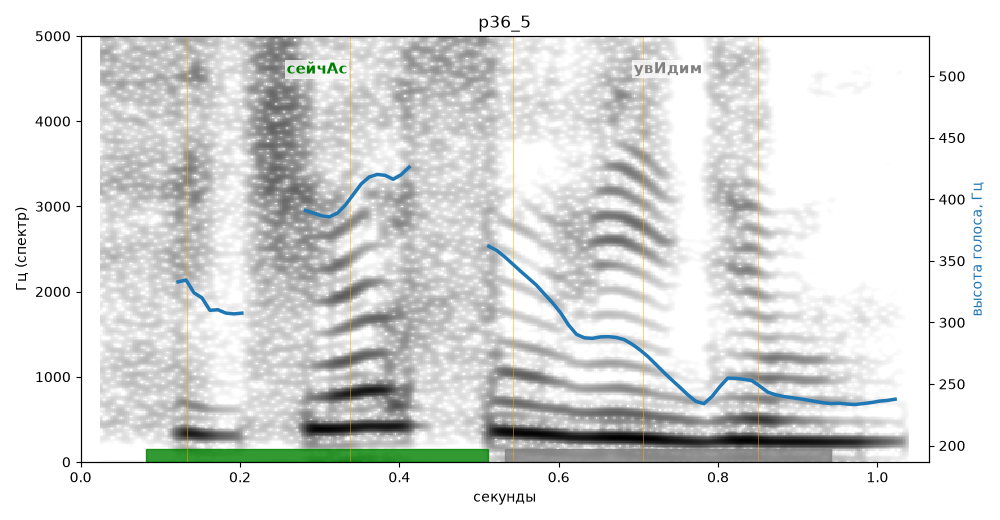

# p36_5

Голос: **Mac Milena** · длительность 1.1 с
Естественность (UTMOS): **2.51 из 5** (живой диктор ≈ 4–4.5)
Эталон: Сейчас увидим.
Распознано: Сейчас увидим.
Слова: все совпали

## Ударения
(где нужно: ruaccent)

| слово | нужно | у голоса | |
|---|---|---|---|
| сейчас | сейчАс | сейчАс | ✓ |
| увидим | увИдим | Увидим | ? не разобрать |

## Интонация
- ✓ «сейчас увидим.» — конец фразы понижается — звучит законченно
- Диапазон голоса 10.1 полутонов (живо), средняя высота 288 Гц

## Паузы и темп
- паузы на своих местах
- Темп 5.8 слога/с (нормально)

_Синяя линия — высота голоса. Над словами заглавная буква — где ударение должно быть; красным — голос поставил не туда (уверенно), оранжевым — возможно._
