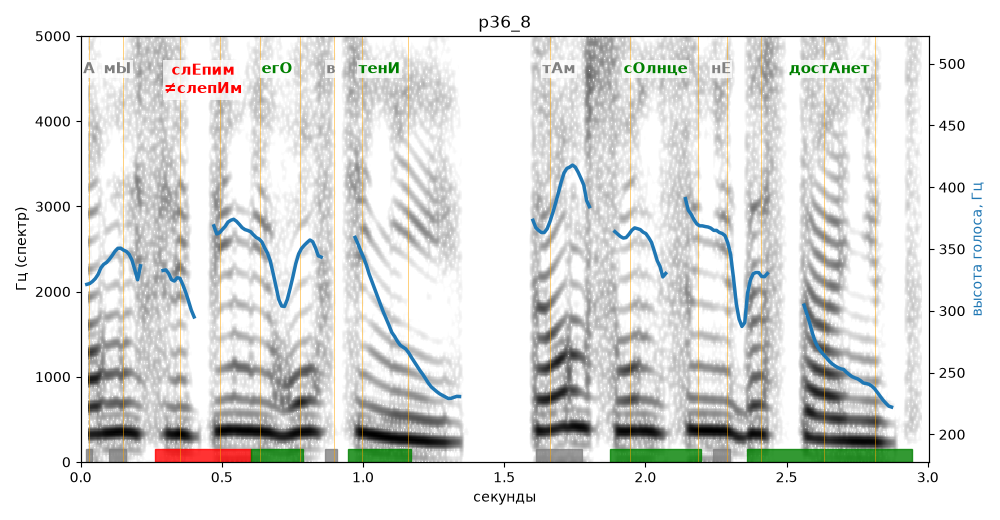

# p36_8

Голос: **Mac Milena** · длительность 3.0 с
Естественность (UTMOS): **2.72 из 5** (живой диктор ≈ 4–4.5)
Эталон: А мы слепим его в тени. Там солнце не достанет.
Распознано: А мы слепим его в тени, там солнце не достанет.
Слова: все совпали

## Ударения
(где нужно: ruaccent)

| слово | нужно | у голоса | |
|---|---|---|---|
| слепим | слЕпим | слепИм | ✗ ОШИБКА |
| его | егО | егО | ✓ |
| тени | тенИ | тенИ | ✓ |
| солнце | сОлнце | сОлнце | ✓ |
| достанет | достАнет | достАнет | ✓ |

## Интонация
- ✓ «а мы слепим его в тени.» — конец фразы понижается — звучит законченно
- ✓ «там солнце не достанет.» — конец фразы понижается — звучит законченно
- Диапазон голоса 9.1 полутонов (живо), средняя высота 333 Гц

## Паузы и темп
- паузы на своих местах
- Темп 6.5 слога/с (нормально)

_Синяя линия — высота голоса. Над словами заглавная буква — где ударение должно быть; красным — голос поставил не туда (уверенно), оранжевым — возможно._
