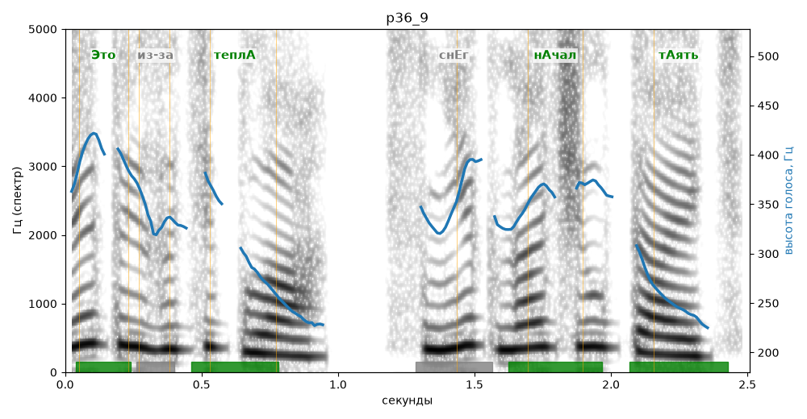

# p36_9

Голос: **Mac Milena** · длительность 2.5 с
Естественность (UTMOS): **2.65 из 5** (живой диктор ≈ 4–4.5)
Эталон: Это из-за тепла. Снег начал таять.
Распознано: Это изотепло, снег начал таять.
Расхождения в словах: «из-за тепла» → «изотепло»

## Ударения
(где нужно: ruaccent)

| слово | нужно | у голоса | |
|---|---|---|---|
| это | Это | Это | ✓ |
| из-за | из-за | Из-за | нет эталона |
| тепла | теплА | теплА | ✓ |
| начал | нАчал | нАчал | ✓ |
| таять | тАять | тАять | ✓ |

## Интонация
- ✓ «это из-за тепла.» — конец фразы понижается — звучит законченно
- ✓ «снег начал таять.» — конец фразы понижается — звучит законченно
- Диапазон голоса 9.7 полутонов (живо), средняя высота 332 Гц

## Паузы и темп
- паузы на своих местах
- Темп 5.3 слога/с (нормально)

_Синяя линия — высота голоса. Над словами заглавная буква — где ударение должно быть; красным — голос поставил не туда (уверенно), оранжевым — возможно._
