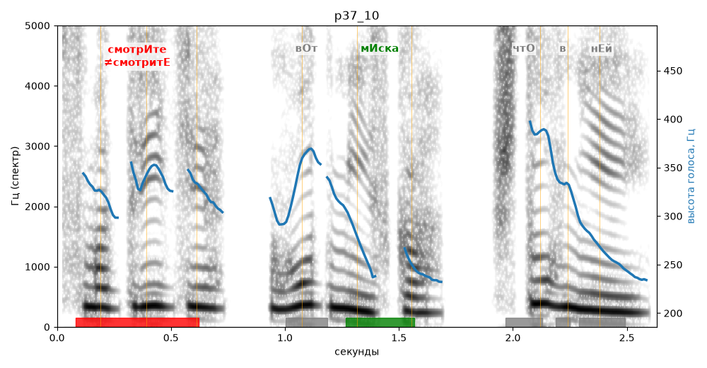

# p37_10

Голос: **Mac Milena** · длительность 2.6 с
Естественность (UTMOS): **2.89 из 5** (живой диктор ≈ 4–4.5)
Эталон: Смотрите, вот миска. Что в ней?
Распознано: Смотрите, год миска, что в ней.
Расхождения в словах: «вот» → «год»

## Ударения
(где нужно: ruaccent)

| слово | нужно | у голоса | |
|---|---|---|---|
| смотрите | смотрИте | смотритЕ | ✗ ОШИБКА |
| миска | мИска | мИска | ✓ |

## Интонация
- ✓ «смотрите вот миска.» — конец фразы понижается — звучит законченно
- ✓ «что в ней?» — конец фразы понижается — звучит законченно
- Диапазон голоса 8.3 полутонов (живо), средняя высота 314 Гц

## Паузы и темп
- паузы на своих местах
- Темп 5.5 слога/с (нормально)

_Синяя линия — высота голоса. Над словами заглавная буква — где ударение должно быть; красным — голос поставил не туда (уверенно), оранжевым — возможно._
