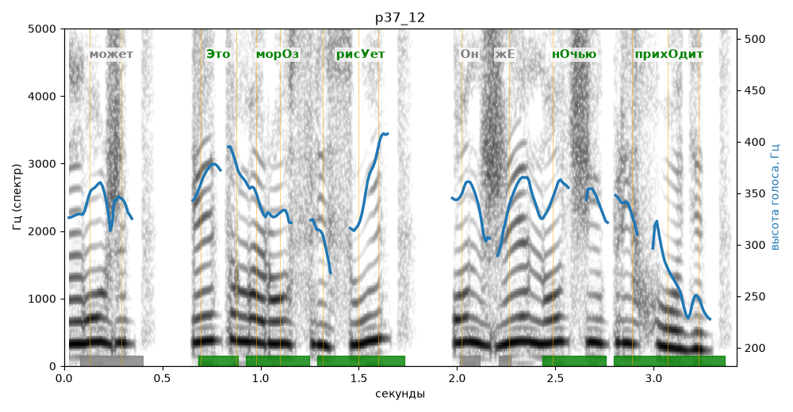

# p37_12

Голос: **Mac Milena** · длительность 3.4 с
Естественность (UTMOS): **2.35 из 5** (живой диктор ≈ 4–4.5)
Эталон: Может, это мороз рисует? Он же ночью приходит.
Распознано: Может, это мороз рисует? Он же ночью приходит.
Слова: все совпали

## Ударения
(где нужно: ruaccent)

| слово | нужно | у голоса | |
|---|---|---|---|
| может | может | мОжет | нет эталона |
| это | Это | Это | ✓ |
| мороз | морОз | морОз | ✓ |
| рисует | рисУет | рисУет | ✓ |
| ночью | нОчью | нОчью | ✓ |
| приходит | прихОдит | прихОдит | ✓ |

## Интонация
- ✗ «может это мороз рисует?» — нет вопросительного подъёма (самое высокое место — «это», в начале) — звучит как утверждение
- ✓ «он же ночью приходит.» — конец фразы понижается — звучит законченно
- Диапазон голоса 7.4 полутонов (живо), средняя высота 340 Гц

## Паузы и темп
- паузы на своих местах
- Темп 5.9 слога/с (нормально)

_Синяя линия — высота голоса. Над словами заглавная буква — где ударение должно быть; красным — голос поставил не туда (уверенно), оранжевым — возможно._
